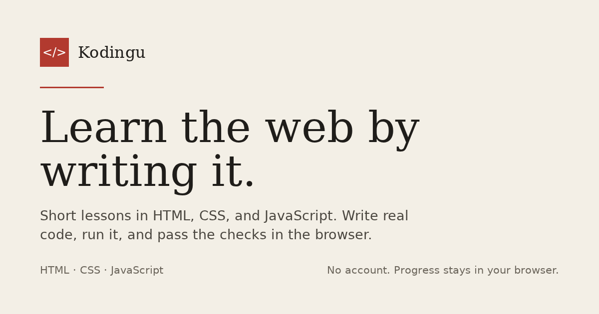

# Kodingu

Kodingu is a free, static learning site for HTML, CSS, and JavaScript. Each lesson introduces one idea, then asks the learner to write code in the browser, run it, and pass a set of checks. The whole learning loop stays in the browser.

[](https://github.com/eiaiproject/Kodingu/actions/workflows/verify.yml) [](LICENSE)

**Live site:** [kodingu.pages.dev](https://kodingu.pages.dev/) · **Source:** [eiaiproject/Kodingu](https://github.com/eiaiproject/Kodingu)



> **Privacy:** there is no account, backend, or AI tutor. Progress, drafts, and preferences stay in `localStorage` on the current browser. No learner code is uploaded.

## Contents

- [Overview](#overview)
- [At a glance](#at-a-glance)
- [Features](#features)
- [How it works](#how-it-works)
- [Courses](#courses)
- [Practice](#practice)
- [Pages](#pages)
- [Stack](#stack)
- [Project structure](#project-structure)
- [Run locally](#run-locally)
- [Quality checks](#quality-checks)
- [Content workflow](#content-workflow)
- [Design and accessibility](#design-and-accessibility)
- [Local data](#local-data)
- [Search and sharing](#search-and-sharing)
- [Deploy](#deploy)
- [Contributing](#contributing)
- [Credits](#credits)
- [License](#license)

## Overview

Kodingu is for learners who want to build pages, not watch a course. A lesson has one objective, a short explanation, a quiz, and a code task. The browser previews the result, runs the checks, and tells the learner what still needs work.

The site is plain HTML, CSS, and ES modules. It has no framework, build step, or runtime dependency. Lesson reading pages are generated and committed, so search engines and readers without JavaScript still get the full lesson text.

## At a glance

| Area | Current state |
| --- | --- |
| Courses | 3: HTML, CSS, and JavaScript |
| Lessons | 70: 32 HTML, 19 CSS, 19 JavaScript |
| Lesson XP | 1,795: 815 HTML, 490 CSS, 490 JavaScript |
| Practice | 4 guided projects and 6 extra challenges |
| Practice XP | 615: 430 projects and 185 challenges |
| Total XP | 2,410 |
| Pages | 12 application pages and 70 generated reading pages |
| Storage | `localStorage` on the learner's browser |
| Runtime | Static HTML, CSS, and ES modules |
| Build | None; the repository root is the deploy output |
| Hosting | Cloudflare Pages |

## Features

- **Browser-native workspace:** edit HTML, CSS, or JavaScript beside a live, sandboxed preview.
- **Checks that explain:** HTML checks parse the document, CSS checks read the stylesheet and preview, and JavaScript checks run in a sandboxed frame.
- **Complete courses:** 70 lessons with quizzes, code tasks, hints, and documented solutions.
- **Extra practice:** four guided projects with build steps and self-checks, plus six standalone challenges.
- **Progress and certificates:** XP, streak, history, course completion, and printable local certificates.
- **Reading pages:** every lesson has a static page for search, sharing, and reading without JavaScript.
- **Offline shell:** the app shell, styles, scripts, and visited pages are cached after the first visit.
- **System-aware theme:** light and dark themes follow the OS by default and can be pinned from the header.
- **Accessible by default:** semantic landmarks, skip links, labelled controls, visible focus, 44px control and label targets, WCAG AA contrast checks, and reduced-motion support.
- **No account or upload:** learner code and progress stay in the browser.

## How it works

1. A page shell loads the shared chrome, the page controller, and the generated course index. A lesson loads only its own data module.
2. The controller reads the query string, resolves the lesson, challenge, or project, and renders the workspace.
3. The editor writes the preview into a sandboxed iframe. HTML checks parse the markup; CSS checks read the stylesheet and preview; JavaScript checks run after a sandboxed preflight.
4. A lesson is complete when the quiz is correct and every check passes. A challenge needs every check, and a project needs its manual self-check list.
5. Progress is written to `localStorage`. Nothing is sent to a server.

The JavaScript preflight runs the learner's script in a worker created inside a hidden sandboxed frame, with network access stubbed out. The worker's opaque origin keeps site storage out of reach, and running off the page thread lets the preflight terminate a script that never finishes. The visible sandboxed frame still runs the code against the real DOM.

Generated files keep the site fast and consistent:

- `assets/js/data/course-index.js` lets list pages avoid importing every lesson.
- `assets/js/data/lessons/` holds one runtime module per lesson.
- `lessons/` holds one static reading page per lesson.
- `sitemap.xml` lists the public URLs.

The data files remain the source of truth. The commands that refresh the generated files are covered in [Content workflow](#content-workflow).

## Courses

| Course | Modules | Lessons | Lesson XP | Coverage |
| --- | ---: | ---: | ---: | --- |
| HTML | 8 | 32 | 815 | Document structure, metadata, semantic sections, links, lists, media, forms and native validation, tables, landmarks, iframes, canvas, SVG, and a capstone page. |
| CSS | 4 | 19 | 490 | Selectors and cascade, color and contrast, typography, the box model, flexbox, grid, responsive layout, custom properties, positioning, motion, components, and fluid type. |
| JavaScript | 5 | 19 | 490 | Values, functions, conditions, loops, DOM updates, events, objects, arrays, errors, closures, classes, JSON, async, forms, local storage, debugging, and a small interactive page. |

Every course lesson has a quiz and a code challenge. A lesson is complete when the quiz is correct and every challenge check passes.

## Practice

### Guided projects

Four projects each open in a single-file workspace with a preview, a download button, build steps, and a manual self-check list.

| Project | Language | Focus |
| --- | --- | --- |
| A recipe page | HTML | Semantic structure, lists, an aside, and a same-page link. |
| A reading room | CSS | Measure, line height, quotation styling, and a narrow-screen step. |
| A field notes counter | JavaScript | State, event handlers, plural labels, and an honest reset. |
| A small studio page | HTML, CSS, and JavaScript | A responsive page with a skip link, focus styles, and one interaction. |

Projects are optional. They add XP, but their checks are manual because a finished page is more than a passing test.

### Extra challenges

Six short challenges sit outside the courses:

- HTML: a session card and a data table.
- CSS: a ticket stub and a responsive quote.
- JavaScript: a tab switcher and a word count.

Challenges use the same editor and checks as lessons. They add XP without changing course progress or certificates.

## Pages

| File | Purpose |
| --- | --- |
| `index.html` | Landing page and working demo. |
| `catalog.html` | Course catalog. |
| `course.html` | Course detail, driven by `?course=`. |
| `lesson.html` | Lesson player, driven by `?course=` and `?lesson=`. |
| `practice.html` | List of extra challenges. |
| `challenge.html` | Challenge workspace, driven by `?challenge=`. |
| `projects.html` | List of guided projects. |
| `project.html` | Project workspace, driven by `?project=`. |
| `progress.html` | XP, streak, lessons, projects, history, and certificates. |
| `certificate.html` | Printable course certificate, driven by `?course=`. |
| `offline.html` | Offline fallback with a skip link and a small navigation landmark. |
| `404.html` | Custom not found page. |
| `lessons/{id}.html` | Static reading page for every lesson, generated from the lesson data. |

On Cloudflare Pages, URLs are served without the `.html` extension. Examples:

- `/course?course=css`
- `/lessons/html-01`
- `/lesson?course=html&lesson=html-01`
- `/project?project=project-recipe`
- `/challenge?challenge=extra-js-01`
- `/certificate?course=html`

## Stack

- Plain HTML, CSS, and JavaScript with ES modules.
- No framework, bundler, transpiler, build step, or runtime dependency.
- Node.js 22 or newer for the local server and verification tooling.
- ESLint for the site modules and tooling scripts.
- Playwright and Chromium for the data, browser, and UI checks.
- Three self-hosted font families, shipped as five Latin woff2 files.
- 20 icons generated from Lucide.
- A service worker for the offline shell.
- A strict Content Security Policy and other security headers in `_headers`.

The site targets modern evergreen browsers with ES modules and service workers. Without a service worker it still works online; offline support is an additional layer.

## Project structure

```text
.
├── .editorconfig
├── .github/
│   ├── CODEOWNERS             Default reviewer for every path
│   ├── PULL_REQUEST_TEMPLATE.md
│   ├── ISSUE_TEMPLATE/        Bug and content issue forms
│   ├── dependabot.yml         Weekly npm and Actions updates
│   └── workflows/
│       ├── verify.yml         CI: lint, verify, and audits on Node 22 and 24
│       ├── codeql.yml         CodeQL analysis
│       └── secret-scan.yml    gitleaks scan of repository history
├── .sonarcloud.properties     SonarCloud scope for course-data duplication
├── .gitignore
├── README.md                  Project overview and development guide
├── CHANGELOG.md               Release notes
├── CONTRIBUTING.md            Setup, checks, and contribution workflow
├── CODE_OF_CONDUCT.md         Community expectations
├── SECURITY.md                Private vulnerability reporting
├── THIRD-PARTY-NOTICES.md     Font and icon attribution
├── LICENSE                    MIT
├── index.html                 Landing page
├── catalog.html               Course catalog
├── course.html                Course detail
├── lesson.html                Lesson player
├── practice.html              Extra challenge list
├── challenge.html             Challenge workspace
├── projects.html              Guided project list
├── project.html               Project workspace
├── progress.html              Progress and certificates
├── certificate.html           Printable certificate
├── offline.html               Offline fallback
├── 404.html                   Not found page
├── lessons/                   Generated reading page per lesson
├── _headers                   Cloudflare Pages security headers
├── sw.js                      Offline cache worker
├── robots.txt                 Crawler rules and sitemap pointer
├── sitemap.xml                Generated list of public URLs
├── favicon.svg                Brand mark and favicon
├── assets/
│   ├── og-image.png           Generated 1200x630 share image
│   ├── fonts/                 Self-hosted Latin woff2 subsets
│   ├── css/
│   │   ├── base.css           Tokens, reset, typography, utilities
│   │   ├── fonts.css          Generated @font-face rules
│   │   ├── static.css         Reading layout for generated lesson pages
│   │   └── app.css            Components and page layouts
│   └── js/
│       ├── core/              Shared chrome, storage, SEO, preview, icons, theme
│       ├── data/              Courses, projects, challenges, test helpers
│       │   └── lessons/       Generated per-lesson runtime data
│       ├── editor/            Editor workspace and sandbox runner
│       └── pages/             One controller per HTML page
├── scripts/
│   ├── dev-server.mjs         Local server that applies _headers
│   ├── verify.mjs             Data and browser verification harness
│   ├── audit-ui.mjs           Layout, contrast, and focus audit
│   ├── fetch-fonts.mjs        Download the Latin font subsets and write fonts.css
│   ├── fetch-icons.mjs        Regenerate core/icons.js from Lucide
│   ├── make-favicon.mjs       Regenerate favicon.svg
│   ├── make-og-image.mjs      Regenerate the share image
│   ├── make-sitemap.mjs       Regenerate sitemap.xml from the course data
│   ├── make-pages.mjs         Regenerate static lesson reading pages
│   ├── make-course-index.mjs  Regenerate the course index and per-lesson data
│   ├── make-lesson-data.mjs   Regenerate data/lessons/ from the lesson data
│   └── series.mjs             Shared sequential task helper
├── LICENSES/                  Full OFL texts for the bundled fonts
├── DESIGN.md                  Visual direction and design log
├── SPACING.md                 Spacing scale, layout rhythm, and exceptions
├── AGENTS.md                  Notes for coding agents
├── package.json               Dev tooling only; the site ships no dependencies
├── package-lock.json          Locked tooling versions
└── eslint.config.js           ESLint rules for the site and tooling
```

## Run locally

Requirements: Node.js 22 or newer and npm. The site itself runs in a modern browser; Node is only for the local server and verification tooling.

```bash
npm install
npx playwright install chromium
npm run dev
```

Open [http://localhost:4173/](http://localhost:4173/).

The dev server reads `_headers`, so the browser runs the same CSP as production, and it resolves `/lesson` to `lesson.html` and `/lessons/html-01` to `lessons/html-01.html` the way Cloudflare Pages does. `PORT` and `HOST` override the defaults.

`python3 -m http.server 4173` also works for a quick look, but it ignores `_headers` and extensionless URLs, so it cannot test the production CSP or routing.

## Quality checks

| Command | What it does |
| --- | --- |
| `npm run lint` | Runs ESLint over the site modules and tooling scripts. |
| `npm run verify` | Runs the data checks and drives Chromium through every lesson, challenge, project, and page. The current suite reports 684 checks. |
| `npm run audit:ui` | Runs a separate Chromium pass for layout, contrast, focus, overflow, and compact-control findings. |
| `npm run audit:deps` | Runs `npm audit --omit=dev`; the site ships no runtime dependencies. |
| `node scripts/verify.mjs --only=data` | Runs one verification group. |

The verification groups are `data`, `headers`, `seo`, `unit`, `lessons`, `challenges`, `projects`, `pages`, `totals`, and `offline`.

`npm run verify` checks the content data, generated course index, generated per-lesson data, and generated reading pages. It then writes each documented solution into the editor, runs the checks, answers the quiz, finishes the work, and asserts the totals on the progress page. It also covers the CSP headers, extensionless URLs, sitemap, skip-link focus, offline worker, and home demo.

The browser audit needs Chromium. If Chromium cannot start, run `npx playwright install-deps chromium` with an account that can install packages.

CI runs `npm run audit:deps`, `npm run lint`, `npm run verify`, and `npm run audit:ui` on Node 22 and 24. Separate workflows run CodeQL analysis and a gitleaks history scan.

## Content workflow

Course and lesson data live in `assets/js/data/`:

- `data.js`: course definitions and the first HTML module.
- `data-html-content.js`: content with meaning, forms and tables, and page structure.
- `data-html-meta-media.js`: search metadata, sharing, responsive images, video, and landmarks.
- `data-html-forms-embeds.js`: form groups, validation, iframes, canvas, SVG, and characters with paths.
- `data-css.js`: CSS foundations.
- `data-css-layout.js`: CSS layout lessons.
- `data-css-modern.js`: custom properties, positioning, and motion.
- `data-css-components.js`: borders, shadows, states, sizing, and fluid type.
- `data-js.js`: JavaScript lessons.
- `data-js-data.js`: objects, array methods, and error handling.
- `data-js-modern.js`: types, strict equality, closures, classes, JSON, and async.
- `data-js-practice.js`: destructuring, form data, local storage, and console debugging.
- `data-projects.js`: guided projects.
- `data-challenges.js`: extra challenges.

A lesson has an `id`, title, estimated minutes, XP, objective, theory blocks, quiz, and challenge. Challenge tests receive `{ doc, raw, css }`:

- HTML lessons receive a parsed document and the source string.
- CSS lessons receive the stylesheet in `raw` and `css`, plus a preview document.
- JavaScript lessons run in a sandboxed runner frame.

After changing lesson text, titles, minutes, XP, or checks:

```bash
npm run course-index
npm run pages
npm run sitemap
npm run verify
```

`npm run course-index` refreshes the catalog, progress data, and per-lesson modules. `npm run pages` regenerates the 70 reading pages, and `npm run sitemap` refreshes the public URL list. `npm run verify` fails when a generated page or data module is stale.

Do not edit these generated files by hand:

- `assets/js/data/course-index.js`
- `assets/js/data/lessons/`
- `lessons/`
- `sitemap.xml`

Other generators:

- `npm run icons` rebuilds `assets/js/core/icons.js` from Lucide.
- `npm run fonts` downloads the Latin font subsets and writes `assets/css/fonts.css`.
- `npm run favicon` rebuilds `favicon.svg`.
- `npm run og-image` rebuilds the 1200x630 share image.
- `npm run lesson-data` refreshes only the per-lesson runtime modules.

After changing the shell (`index.html`, CSS, JavaScript, fonts, or icons), bump `CACHE` in `sw.js`.

## Design and accessibility

- [DESIGN.md](DESIGN.md) records the visual direction.
- [SPACING.md](SPACING.md) is the spacing contract: a 4px-based scale, three section tiers, three grid tiers, and the small optical/print exceptions.

The theme follows the OS by default, uses `light-dark()` tokens, and exposes a two-state toggle that returns to the system choice when the target matches it. The static reading pages include the same theme bootstrap, so they do not flash a different palette.

The site uses one `main` and one `h1` per page, labelled navigation and complementary landmarks, a skip link, keyboard-operable controls, visible focus, and reduced-motion support. Buttons, primary navigation, and form-control labels use at least 44px targets at 1024px and below or on coarse pointers; native radio and checkbox inputs sit inside those labels. `npm run audit:ui` checks contrast, overflow, focus, symmetric shells, grid gaps, and line length in light and dark themes.

## Local data

Kodingu stores these keys in `localStorage`:

- `kodingu.progress.v1`: XP, streak, history, and completed lessons, challenges, and projects.
- `kodingu.progress.corrupt.v1`: the raw saved record kept when progress cannot be read, so it can be exported for recovery.
- `kodingu.theme`: the selected light or dark theme.
- `kodingu.draft.<lessonId>`: the current lesson draft.
- `kodingu.challengeDraft.<challengeId>`: the current challenge draft.
- `kodingu.projectDraft.<projectId>`: the current project draft.
- `kodingu.certificate.name`: the name used on a certificate.

Clear site data to remove progress, drafts, the theme, and the certificate name. **Reset progress** on the progress page clears XP, streak, completed work, saved drafts, and the certificate name, but keeps the theme. There is no server copy to restore.

**Export JSON** writes the progress, schema version, export date, and certificate name. **Import JSON** restores that file in another browser. Imports are limited to 1 MB, checked for the Kodingu format and a supported schema version, and filtered against the lessons, challenges, and projects that exist here. The imported XP total is recalculated from the surviving entries, so a file cannot invent progress. `migrateProgress()` carries unversioned legacy data forward to version 2.

If the browser blocks local storage, progress stays in memory for the current page and is lost on reload.

## Search and sharing

Every indexable page carries a description, canonical URL, Open Graph and Twitter tags, and a robots rule. The offline and 404 pages are noindex and carry only the metadata they need. The home page and catalog also carry JSON-LD.

- `assets/og-image.png` is the 1200x630 share image. Rebuild it with `npm run og-image`.
- `lessons/{id}.html` is the readable version of every lesson. It carries the theory, goal, challenge prompt, previous and next links, and `LearningResource` JSON-LD. It works without JavaScript. Rebuild these pages with `npm run pages`.
- The interactive workspace at `/lesson?course=...` canonicalizes to its reading page at `/lessons/{id}`. Search engines see one lesson URL, and every reading page links to the workspace.
- `sitemap.xml` lists the public home, catalog, practice and projects indexes, course pages, and lesson reading pages. Project, challenge, progress, certificate, offline, and 404 pages are noindex or excluded.
- `robots.txt` points crawlers at the sitemap.

The reading pages are generated files, not request-time prerendering. They are committed and served as-is, so the deploy still has no build step.

## Deploy

The live site is deployed on Cloudflare Pages at [https://kodingu.pages.dev/](https://kodingu.pages.dev/).

To deploy the same static site, connect the repository to Cloudflare Pages with these settings:

| Setting | Value |
| --- | --- |
| Production branch | `main` |
| Build command | Leave empty |
| Output directory | Repository root |

`_headers` adds the security policy. `sw.js` registers on HTTPS or localhost and provides the offline shell.

### Rollback

Cloudflare Pages keeps every deployment. Open the project's **Deployments** tab, choose the last known good deployment, and use **Rollback to this deployment**. The site has no build step, so the rollback serves the committed files from that deployment.

### Security and caching

`_headers` sets a strict Content Security Policy. `style-src 'unsafe-inline'` stays because progress bars write an inline width and the preview injects its base stylesheet into a sandboxed frame. `frame-ancestors 'none'` and `X-Frame-Options: DENY` both block framing; the header stays for older browsers. `object-src 'none'` blocks plugin content. The policy also sets `Cross-Origin-Opener-Policy: same-origin` and a restrictive `Permissions-Policy`.

HSTS is not set for the `pages.dev` host. When the site moves to a custom domain that is HTTPS-only, add `Strict-Transport-Security: max-age=31536000; includeSubDomains` to `_headers`.

HTML, scripts, and styles keep revalidating because their file names are not hashed. Font files carry a one-year immutable cache; rename a font file when its contents change. The service worker keeps its own copy and uses network-first requests for scripts and styles, so a deploy is picked up without a year-long stale cache.

## Contributing

The repository is [eiaiproject/Kodingu](https://github.com/eiaiproject/Kodingu). Read [CONTRIBUTING.md](CONTRIBUTING.md) for setup, checks, and the content workflow. Participation is covered by [CODE_OF_CONDUCT.md](CODE_OF_CONDUCT.md); report vulnerabilities through [SECURITY.md](SECURITY.md). Release notes live in [CHANGELOG.md](CHANGELOG.md).

Before opening a pull request, run:

```bash
npm run lint
npm run verify
npm run audit:ui
npm run audit:deps
```

Keep the site free of a build step and runtime dependencies. Use the spacing tokens in `SPACING.md`, keep progress storage compatible with `kodingu.progress.v1`, and add a migration for schema changes. [AGENTS.md](AGENTS.md) lists the repository rules.

## Credits

- Icons: [Lucide](https://lucide.dev) (ISC).
- Fonts: Shippori Mincho, Public Sans, and IBM Plex Mono, self-hosted as Latin woff2 subsets.
- Syllabus references: [MDN Web Docs](https://developer.mozilla.org/en-US/) and [W3Schools](https://www.w3schools.com/).
- Design and copy rules: [anti-slop](https://github.com/miqdadbadjuber/anti-slop).
- Source: [eiaiproject/Kodingu](https://github.com/eiaiproject/Kodingu).

## License

MIT. See [LICENSE](LICENSE). The bundled fonts are under the SIL Open Font License 1.1; see [THIRD-PARTY-NOTICES.md](THIRD-PARTY-NOTICES.md).
