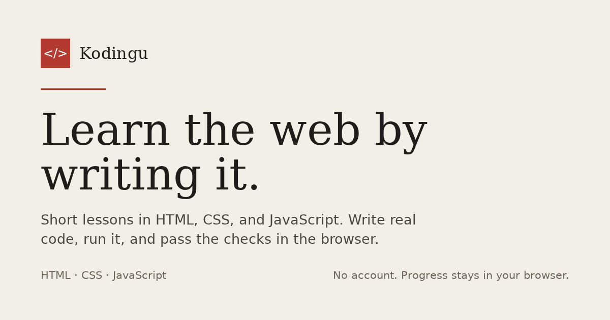

# Kodingu

Kodingu is a free, static learning site for HTML, CSS, and JavaScript. Each lesson explains one idea, then asks you to write code in the browser, run it, and pass a set of checks. The courses start with the basics and build toward complete pages.

[](https://github.com/eiaiproject/Kodingu/actions/workflows/verify.yml)

**Live site:** [kodingu.pages.dev](https://kodingu.pages.dev/) · **Source:** [eiaiproject/Kodingu](https://github.com/eiaiproject/Kodingu)



There is no account, backend, or AI tutor. Progress, drafts, and preferences stay in `localStorage` on the current browser. No code is uploaded.

## Contents

- [Features](#features)
- [Stack](#stack)
- [How it works](#how-it-works)
- [Courses](#courses)
- [Practice](#practice)
- [Progress](#progress)
- [Using the site](#using-the-site)
- [Pages](#pages)
- [Project structure](#project-structure)
- [Run locally](#run-locally)
- [Verify](#verify)
- [Search and sharing](#search-and-sharing)
- [Deploy](#deploy)
- [Development workflow](#development-workflow)
- [Adding or editing content](#adding-or-editing-content)
- [Local data](#local-data)
- [Accessibility](#accessibility)
- [Contributing](#contributing)
- [Credits and references](#credits-and-references)
- [License](#license)

## Features

- **3 courses:** HTML, CSS, and JavaScript.
- **70 lessons:** 32 HTML, 19 CSS, and 19 JavaScript.
- **1,795 lesson XP:** 815 HTML, 490 CSS, and 490 JavaScript.
- **4 guided projects:** a recipe page, a reading room, a field notes counter, and a small studio page.
- **6 extra challenges:** two HTML, two CSS, and two JavaScript.
- **615 practice XP:** 430 from guided projects and 185 from extra challenges.
- **In-browser editor:** live preview, run controls, automated checks, hints, and solutions.
- **Progress:** XP, streak, history, and course certificates, all stored in this browser.
- **Accessible by default:** light and dark themes, responsive layouts, keyboard controls, and reduced-motion support.
- **Offline after the first visit:** the shell, styles, scripts, and visited pages are cached. Each lesson data module is cached when you open it; a lesson you have not opened needs a connection.
- **Readable lesson pages:** every lesson has a static page for search, sharing, and reading without JavaScript.

## Stack

Plain HTML, CSS, and JavaScript with ES modules. No framework, build step, or runtime dependency ships with the site. Icons are generated from Reicon, and the three fonts are self-hosted as Latin woff2 subsets. `package.json` exists only for local verification tooling.

The site runs in modern browsers with ES modules and service workers. Without a service worker it still works online; offline support is the extra layer.

## How it works

Kodingu keeps the learning loop in the browser:

1. A page shell loads `core/app.js`, the page controller, and the course index. A lesson then loads only its own data module.
2. The controller reads the query string, finds the lesson, challenge, or project, and renders it.
3. The editor writes a preview into a sandboxed iframe. HTML checks parse the markup, CSS checks read the stylesheet and preview, and JavaScript checks run in a separate sandboxed frame after a Worker preflight stops scripts that never finish.
4. A lesson is finished when its quiz is correct and every check passes. A challenge needs every check, and a project needs its self-check list.
5. Progress is written to `localStorage`. Learner data is not sent to a server.

The JavaScript preflight runs the learner's script in a Worker with a no-op DOM. It only checks that the script finishes. The sandboxed frame still runs the code against the real DOM.

`assets/js/data/course-index.js` is generated from the lesson data so list pages do not import every lesson. The generated files under `assets/js/data/lessons/` hold one module per lesson for the interactive workspace. Run `npm run course-index` after changing any lesson content, title, minutes, or XP. The source of truth remains the files under `assets/js/data/`; `npm run lesson-data` refreshes only the per-lesson modules when you need that.

`lessons/` holds one generated reading page per lesson. Run `npm run pages` after editing lesson text, and `npm run sitemap` after adding or removing content. `npm run verify` checks that both outputs match the data.

## Courses

| Course | Modules | Lessons | Lesson XP | What it covers |
| --- | ---: | ---: | ---: | --- |
| HTML | 8 | 32 | 815 | Document structure, headings, paragraphs, links, lists, images, quotations, code, figures, semantic sections, forms and native validation, tables, ids, classes, comments, metadata and search, Open Graph, JSON-LD, responsive images, video and captions, landmarks, iframes, canvas, SVG, characters and file paths, and a capstone page. |
| CSS | 4 | 19 | 490 | Rules, selectors, the cascade, color and contrast, typography, the box model, flexbox, grid, responsive layout, custom properties, positioning, motion, borders and shadows, interaction states, box sizing, overflow, object-fit, and fluid type. |
| JavaScript | 5 | 19 | 490 | Values, variables, functions, conditions, loops, DOM updates, events, objects, array methods, error handling, types and strict equality, closures, classes, JSON, async, destructuring, form data, local storage, console debugging, and a small interactive page. |

Every course lesson has a quiz and a code challenge. A lesson is complete when the quiz is correct and every challenge check passes.

## Practice

### Guided projects

There are four projects. Each one opens in a single-file workspace with a preview, a download button, build steps, and a manual self-check list.

| Project | Language | Focus |
| --- | --- | --- |
| A recipe page | HTML | Semantic structure, lists, an aside, and a same-page link. |
| A reading room | CSS | Measure, line height, quotation styling, and a narrow-screen step. |
| A field notes counter | JavaScript | State, event handlers, plural labels, and an honest reset. |
| A small studio page | HTML, CSS, and JavaScript | A responsive page with a skip link, focus styles, and one interaction. |

Projects are practice, not a course requirement. They add XP, and the checks are manual because a finished page is more than a passing test.

### Extra challenges

Six short challenges sit outside the courses:

- HTML: a session card and a data table.
- CSS: a ticket stub and a responsive quote.
- JavaScript: a tab switcher and a word count.

Challenges use the same editor and checks as lessons. They add XP without changing course progress or certificates.

## Progress

Finishing a lesson adds its XP once and keeps the day's streak. Extra challenges and guided projects add XP to the same total but do not change course completion.

The progress page shows XP, the current streak, finished lessons, finished projects, course progress, history, and certificates. There is no public leaderboard: every number comes from work finished in this browser. Certificates are printable local records, not verified credentials.

## Using the site

1. Open the live site or run it locally.
2. Open the catalog and choose a course. HTML is the recommended starting point.
3. Read the lesson, answer the quiz, then write your code in the editor.
4. Use **Run** to refresh the preview and **Check** to test your work.
5. Finish the lesson when the quiz is correct and every check passes.
6. Open the progress page to see XP, streak, lessons, projects, history, and certificates.
7. Use the projects and extra challenges when you want a larger or different exercise.

The interface is in English. Nothing on the site requires an account, payment, or external editor.

## Pages

| File | Purpose |
| --- | --- |
| `index.html` | Landing page and working demo. |
| `catalog.html` | Course catalog. |
| `course.html` | Course detail, driven by `?course=`. |
| `lesson.html` | Lesson player, driven by `?course=` and `?lesson=`. |
| `practice.html` | List of extra challenges. |
| `challenge.html` | Challenge workspace, driven by `?challenge=`. |
| `projects.html` | List of guided projects. |
| `project.html` | Project workspace, driven by `?project=`. |
| `progress.html` | XP, streak, lessons, projects, history, and certificates. |
| `certificate.html` | Printable course certificate, driven by `?course=`. |
| `lessons/{id}.html` | Static reading page for every lesson, generated from the lesson data. |
| `404.html` | Custom not found page. |

On Cloudflare Pages, page URLs are served without the `.html` extension. For example:

- `/course?course=css`
- `/lessons/html-01`
- `/lesson?course=html&lesson=html-01` (the interactive workspace)
- `/project?project=project-recipe`
- `/challenge?challenge=extra-js-01`
- `/certificate?course=html`

## Project structure

```text
.
├── .editorconfig
├── .github/workflows/verify.yml  CI: lint, verify, and audit on Node 22 and 24
├── .github/dependabot.yml     Weekly npm and Actions updates
├── .sonarcloud.properties     SonarCloud scope for course-data duplication
├── .gitignore
├── README.md                  Project overview and development guide
├── SECURITY.md                Private vulnerability reporting
├── THIRD-PARTY-NOTICES.md     Font and icon attribution
├── LICENSE                    MIT
├── index.html                 Landing page
├── catalog.html               Course catalog
├── course.html                Course detail
├── lesson.html                Lesson player
├── practice.html              Extra challenge list
├── challenge.html             Challenge workspace
├── projects.html              Guided project list
├── project.html               Project workspace
├── progress.html              Progress and certificates
├── certificate.html           Printable certificate
├── offline.html               Offline fallback page
├── 404.html                   Not found page
├── lessons/                   Generated static reading page per lesson
├── _headers                   Cloudflare Pages security headers
├── sw.js                      Offline cache worker
├── robots.txt                 Crawler rules and sitemap pointer
├── sitemap.xml                Generated list of public URLs
├── favicon.svg                Brand mark and favicon
├── assets/
│   ├── og-image.png           Generated 1200x630 share image
│   ├── fonts/                 Self-hosted Latin woff2 subsets
│   ├── css/
│   │   ├── base.css           Tokens, reset, typography, utilities
│   │   ├── fonts.css          Generated @font-face rules
│   │   ├── static.css         Reading layout for generated lesson pages
│   │   └── app.css            Components and page layouts
│   └── js/
│       ├── core/              Shared chrome, storage, SEO, preview, icons
│       ├── data/              Courses, projects, challenges, test helpers
│       │   └── lessons/       Generated per-lesson runtime data
│       ├── editor/            Editor workspace and sandbox runner
│       └── pages/             One controller per HTML page
├── scripts/
│   ├── dev-server.mjs         Local server that applies _headers
│   ├── verify.mjs             Data and browser verification harness
│   ├── audit-ui.mjs           Layout, contrast, and focus audit
│   ├── fetch-fonts.mjs        Download the Latin font subsets and write fonts.css
│   ├── fetch-icons.mjs        Regenerate core/icons.js from Reicon
│   ├── make-favicon.mjs       Regenerate favicon.svg
│   ├── make-og-image.mjs      Regenerate the share image
│   ├── make-sitemap.mjs       Regenerate sitemap.xml from the course data
│   ├── make-pages.mjs         Regenerate static lesson reading pages
│   ├── make-course-index.mjs  Regenerate the course index and per-lesson data
│   ├── make-lesson-data.mjs   Regenerate data/lessons/ from the lesson data
│   └── series.mjs             Shared sequential task helper
├── LICENSES/                  Full OFL texts for the bundled fonts
├── DESIGN.md                  Visual direction and design log
├── AGENTS.md                  Notes for coding agents
├── package.json               Dev tooling only; the site ships no dependencies
├── package-lock.json          Locked tooling versions
└── eslint.config.js           ESLint rules for the site and tooling
```

## Run locally

Requirements: Node.js 22 or newer and npm. The site itself runs in any modern browser; Node is only for the local server and verification tooling.

ES modules and the security headers need an HTTP server. From the project root:

```bash
npm install
npm run dev
```

Open [http://localhost:4173/](http://localhost:4173/).

The dev server reads `_headers`, so the browser runs the same CSP as production, and it resolves `/lesson` to `lesson.html` and `/lessons/html-01` to `lessons/html-01.html` the way Cloudflare Pages does. `PORT` and `HOST` override the defaults.

`python3 -m http.server 4173` also works for a quick look, but it ignores `_headers` and the extensionless URLs, so the security policy and the script runner cannot be tested that way.

## Verify

```bash
npm install
npx playwright install chromium
npm run lint
npm run verify
```

The harness starts the dev server, checks the content data (unique IDs, XP totals, quiz answers, check functions, previews), the generated course index, the generated per-lesson data, and the generated lesson pages, then drives Chromium through every lesson, challenge, project, and course page. It writes each documented solution into the editor, runs the checks, answers the quiz, finishes the work, and asserts the totals on the progress page. It also checks the CSP headers, the extensionless URLs, the sitemap, skip-link focus, the offline worker, and the home demo.

`node scripts/verify.mjs --only=data` runs a single group. Groups: `data`, `headers`, `seo`, `unit`, `lessons`, `challenges`, `projects`, `pages`, `totals`, `offline`.

`npm run lint` checks the site modules and tooling scripts with ESLint.

`npm run audit` runs a separate Chromium pass for layout, contrast, focus, and compact-control findings.

SonarCloud runs automatic analysis for pull requests. `.sonarcloud.properties` keeps course data and the generated index out of copy-paste detection because they share a deliberate schema; runtime code remains in the duplication metric.

Chromium needs system libraries. If it cannot start, run `npx playwright install-deps chromium` with an account that can install packages.

## Search and sharing

Every page carries a description, a canonical URL, Open Graph and Twitter tags, and a robots rule. The home page and catalog also carry JSON-LD (WebSite and an ItemList of Course). Course, lesson, project, challenge, and certificate pages rewrite the canonical URL, title, and description at runtime from the page path and the canonical origin.

- `assets/og-image.png` is the 1200x630 share image. Rebuild it with `npm run og-image`.
- `lessons/{id}.html` is the readable version of every lesson. It carries the theory, the goal, the challenge prompt, previous and next links, and `LearningResource` JSON-LD. It works without JavaScript. Rebuild these pages with `npm run pages`.
- The interactive workspace at `/lesson?course=...` canonicalizes to its reading page at `/lessons/{id}`. Search engines see one lesson URL, and every reading page links to the workspace.
- `sitemap.xml` lists every public course, reading page, project, and challenge. Rebuild it with `npm run sitemap` after adding content.
- `robots.txt` points crawlers at the sitemap, and `404.html` is marked noindex.

The reading pages are generated files, not request-time prerendering. They are committed and served as-is, so the deploy still has no build step.

## Deploy

The live site is deployed on Cloudflare Pages at [https://kodingu.pages.dev/](https://kodingu.pages.dev/).

To deploy the same static site, connect the repository to Cloudflare Pages with these settings:

| Setting | Value |
| --- | --- |
| Production branch | `main` |
| Build command | Leave empty |
| Output directory | Repository root |

`_headers` adds the security policy. `sw.js` registers on HTTPS or localhost and provides the offline shell.

### Rollback

Cloudflare Pages keeps every deployment. Open the project's **Deployments** tab, choose the last known good deployment, and use **Rollback to this deployment**. The site has no build step, so the rollback serves the committed files from that deployment.

### Security headers

`_headers` sets a strict content security policy. `style-src 'unsafe-inline'` stays because progress bars write an inline width and the preview injects its base stylesheet into a sandboxed frame. `frame-ancestors 'none'` and `X-Frame-Options: DENY` both block framing; the header stays for older browsers. `object-src 'none'` blocks plugin content.

HSTS is not set for the `pages.dev` host. When the site moves to a custom domain that is HTTPS-only, add `Strict-Transport-Security: max-age=31536000; includeSubDomains` to `_headers`.

Assets keep revalidating because their file names are not hashed. The service worker keeps its own copy and uses network-first requests for scripts and styles, so a deploy is picked up without a year-long stale cache.

## Development workflow

1. Clone the repository and start the local server.
2. Create a branch for the change.
3. Edit the files and test the affected pages in the browser.
4. Commit and push the branch.
5. Merge to `main`. A connected Cloudflare Pages project deploys `main` automatically.

`npm run verify` is the main automated check. `npm run lint` checks the JavaScript. `npm run audit` adds a browser layout, contrast, and focus pass. There is no build or formatting step.

## Adding or editing content

Course and lesson data live in `assets/js/data/`:

- `data.js`: course definitions and the first HTML module.
- `data-html-content.js`: content with meaning, forms and tables, and page structure.
- `data-html-meta-media.js`: search metadata, sharing, responsive images, video, and landmarks.
- `data-html-forms-embeds.js`: form groups, validation, iframes, canvas, SVG, and characters with paths.
- `data-css.js`: CSS foundations.
- `data-css-layout.js`: CSS layout lessons.
- `data-css-modern.js`: custom properties, positioning, and motion.
- `data-css-components.js`: borders, shadows, states, sizing, and fluid type.
- `data-js.js`: JavaScript lessons.
- `data-js-data.js`: objects, array methods, and error handling.
- `data-js-modern.js`: types, strict equality, closures, classes, JSON, and async.
- `data-projects.js`: guided projects.
- `data-challenges.js`: extra challenges.

A lesson has an `id`, title, estimated minutes, XP, objective, theory blocks, quiz, and challenge. Challenge tests receive `{ doc, raw, css }`:

- HTML lessons receive a parsed document and the source string.
- CSS lessons receive the stylesheet in `raw` and `css`, plus a preview document.
- JavaScript lessons run in a sandboxed runner frame.

After editing content, run `npm run course-index` so the catalog, progress pages, and per-lesson modules see the change, then `npm run pages` to regenerate the reading pages and `npm run sitemap` to refresh the public URL list. Start the local server and open the affected lesson or project. The browser is the test environment. `npm run verify` fails when a generated lesson page or lesson data module is stale, so a forgotten regeneration does not reach the deploy.

To regenerate the icon set from Reicon, run `npm run icons`. To rebuild the favicon from the Code icon, run `npm run favicon`. To refresh the self-hosted font files, run `npm run fonts`. The scripts need Node 22 or newer.

## Local data

Kodingu stores these keys in `localStorage`:

- `kodingu.progress.v1`: XP, streak, history, and completed lessons, challenges, and projects.
- `kodingu.theme`: the selected light or dark theme.
- `kodingu.draft.<lessonId>`: the current lesson draft.
- `kodingu.challengeDraft.<challengeId>`: the current challenge draft.
- `kodingu.projectDraft.<projectId>`: the current project draft.
- `kodingu.certificate.name`: the name used on a certificate.

Clear site data in the browser to remove progress, drafts, the theme, and the certificate name. **Reset progress** on the progress page clears XP, streak, and completed work, but keeps drafts and the theme. There is no server copy to restore.

**Export JSON** writes a copy of the progress, schema version, export date, and certificate name. **Import JSON** restores that file in another browser. Imports are limited to 1 MB, checked for the Kodingu format and a supported schema version, and filtered against the lessons, challenges, and projects that exist here. The imported XP total is recalculated from the surviving entries, so a file cannot invent progress. `migrateProgress()` carries unversioned legacy data forward to version 2.

If the browser blocks local storage, progress stays in memory for the current page and is lost on reload.

## Accessibility

The site uses semantic landmarks, a skip link that moves focus to main, visible focus styles, keyboard-operable controls, 44px touch targets at 1024px and below and for coarse pointers, WCAG AA contrast checks, light and dark themes, and reduced-motion support.

## Contributing

The repository is [eiaiproject/Kodingu](https://github.com/eiaiproject/Kodingu). Before opening a pull request, run `npm run lint` and `npm run verify`. Keep the site free of a build step and runtime dependencies; [AGENTS.md](AGENTS.md) lists the repository rules.

## Credits and references

- Icons: [Reicon](https://reicon.dev) (MIT).
- Fonts: Shippori Mincho, Public Sans, and IBM Plex Mono, self-hosted as Latin woff2 subsets.
- Source: [eiaiproject/Kodingu](https://github.com/eiaiproject/Kodingu).
- Syllabus references: [MDN Web Docs](https://developer.mozilla.org/en-US/), [W3Schools](https://www.w3schools.com/).
- Design and copy rules: [anti-slop](https://github.com/miqdadbadjuber/anti-slop).

## License

MIT. See [LICENSE](LICENSE). The bundled fonts are under the SIL Open Font License 1.1; see [THIRD-PARTY-NOTICES.md](THIRD-PARTY-NOTICES.md).
